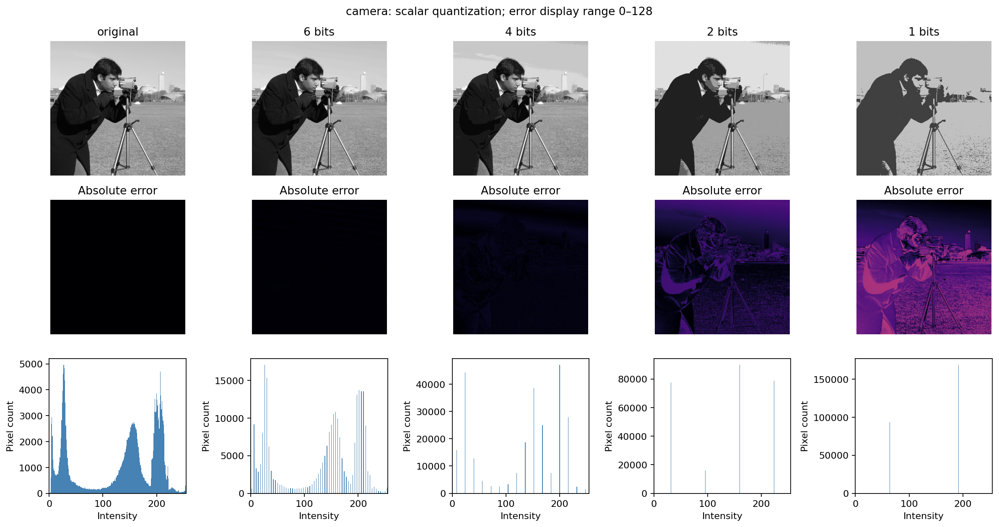
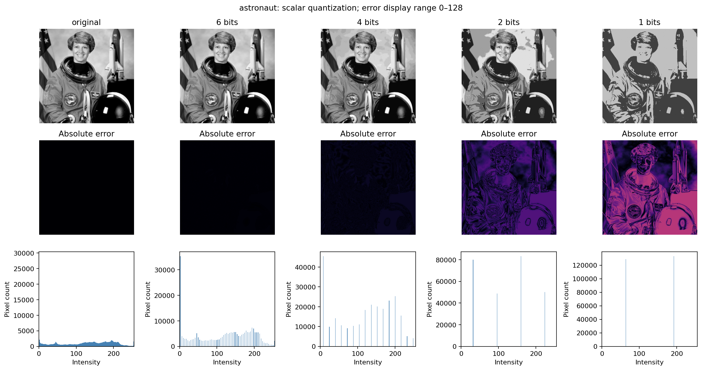
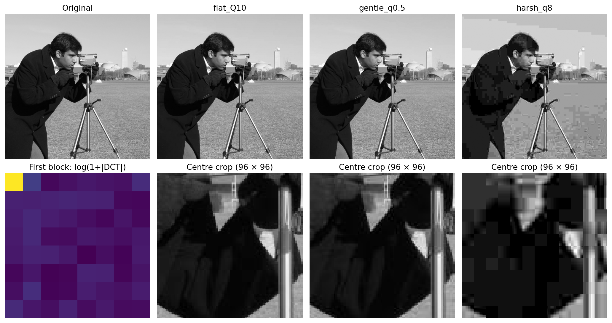
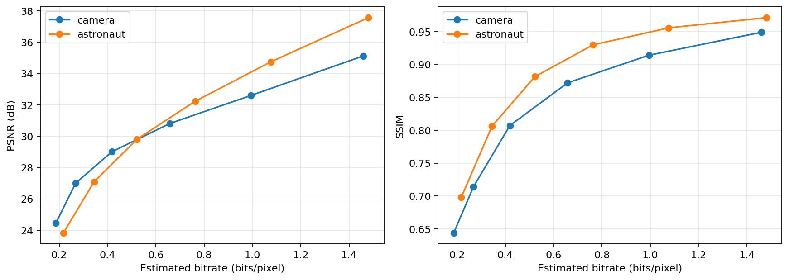
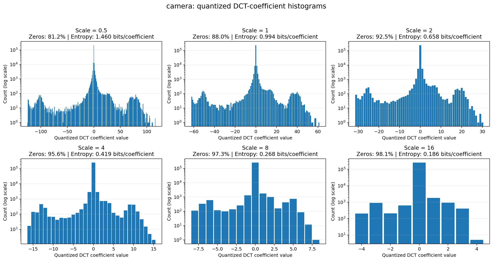
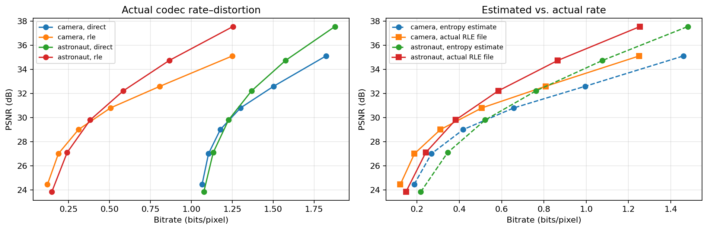

# JPEG-Like Image Compression

This lab investigates how quantization and transform coding affect image reconstruction quality and compressed data size.

Two images, `camera` and `astronaut`, were processed in 8-bit grayscale.

The experiments begin with uniform scalar quantization, followed by block-based DCT compression, rate-distortion analysis, visual quality comparison, and a custom JPEG-like encoder and decoder.

## 1. Uniform Scalar Quantization

### 1.1 Quantization implementation

Uniform midpoint quantization was applied to the grayscale images.

The pixel intensity range was divided into equally sized intervals, and each pixel was reconstructed using the midpoint of its corresponding interval.

The tested bit depths included:

- 1 bit - 2 levels
- 2 bits - 4 levels
- 4 bits - 16 levels
- 6 bits - 64 levels

The reconstructed images were compared with the original images to observe how reducing the number of intensity levels affected visual quality.

Absolute quantization errors and intensity histograms were also generated.

### 1.2 Quantization results

The reconstructed images were evaluated using Peak Signal-to-Noise Ratio (PSNR).

For the `camera` image:

| Bit depth | PSNR |
|---|---:|
| 2 bits | 23.63 dB |
| 4 bits | 34.96 dB |
| 6 bits | 46.33 dB |

Increasing the bit depth reduced quantization error and improved reconstruction quality.

At lower bit depths, visible banding appeared because multiple original intensity values were represented by the same reconstruction level.

Higher bit depths produced smaller intensity steps and preserved more of the original tonal variation.

## 2. Block-Based DCT and Quantization

### 2.1 DCT implementation

The images were divided into **8 × 8 blocks**.

Image dimensions were padded where necessary so that the entire image could be processed using complete blocks.

Before applying the DCT, pixel values were shifted by subtracting 128.

A two-dimensional orthonormal DCT was then applied to each block.

The transformed coefficients were quantized by dividing them by a quantization matrix and rounding the results.

For reconstruction, the quantized coefficients were multiplied by the quantization matrix, followed by the inverse DCT.

The level shift was reversed, and the reconstructed image was cropped back to its original dimensions.

### 2.2 Quantization matrices

Three quantization settings were compared:

- **Flat quantization:** `Q = 10`
- **Gentle frequency-weighted quantization:** `q = 0.5`
- **Harsh frequency-weighted quantization:** `q = 8`

The flat matrix applied the same quantization step to all DCT coefficients.

The frequency-weighted matrices applied different quantization strengths depending on the coefficient positions.

This allowed the experiment to examine the effect of quantizing different frequency components with different strengths.

### 2.3 Reconstruction results

The reconstructed images were evaluated using:

- Mean Squared Error (MSE)
- Peak Signal-to-Noise Ratio (PSNR)
- Structural Similarity Index (SSIM)
- Percentage of zero-valued quantized DCT coefficients

For the `camera` image:

| Quantization setting | PSNR | Zero coefficients |
|---|---:|---:|
| Flat, Q = 10 | 41.43 dB | 70.1% |
| Gentle, q = 0.5 | 35.12 dB | 81.2% |
| Harsh, q = 8 | 27.00 dB | 97.3% |

The harsh setting produced the highest percentage of zero coefficients but also the lowest PSNR.

Aggressive quantization removed more transform information, resulting in increased reconstruction distortion.

The flat setting retained more image detail and produced the highest PSNR among these three configurations.

An important distinction in this experiment is that the DCT itself does not intentionally discard information. Most of the reconstruction loss is introduced when the transformed coefficients are rounded during quantization.

## 3. Rate-Distortion Analysis

### 3.1 Quantization strength

The frequency-weighted quantization strength was varied using:

- q = 0.5
- q = 1
- q = 2
- q = 4
- q = 8
- q = 16

Each configuration produced a different set of quantized DCT coefficients and a corresponding reconstructed image.

The experiment examined how the reconstruction quality changed as the quantization strength increased.

### 3.2 Distortion measurements

Three quality measurements were calculated:

**MSE:** Measures the average squared reconstruction error.

**PSNR:** Expresses reconstruction quality relative to the maximum possible pixel intensity.

**SSIM:** Measures structural similarity between the original and reconstructed images.

Using these measurements together allowed the quantization settings to be compared numerically.

### 3.3 Estimated bit rate

The entropy of the signed quantized DCT coefficients was calculated.

The entropy estimate was adjusted using the number of padded coefficients and the original image dimensions to obtain an estimated bit rate in bits per pixel (bpp).

For the `camera` image:

| Quantization strength | Estimated rate | PSNR |
|---|---:|---:|
| q = 0.5 | 1.460 bpp | 35.12 dB |
| q = 2 | 0.658 bpp | 30.81 dB |

Increasing the quantization strength from 0.5 to 2 reduced the estimated bit rate, but it also reduced the reconstructed image quality.

This demonstrated the rate-distortion trade-off: stronger quantization requires fewer bits to represent the coefficients but introduces greater reconstruction error.

The estimated bpp values represent coefficient entropy rather than the actual compressed file size.

The file-based compression measurements were performed separately in the final experiment.

## 4. Visual Quality Comparison

A blind visual comparison was prepared to investigate how different quantization methods affect perceived image quality.

Four reconstructed conditions were generated for comparison.

The experiment searched for reconstructions using flat and frequency-weighted quantization matrices with PSNR values close to **30 dB**.

The purpose was to compare images with approximately similar numerical quality but potentially different visible compression artifacts.

A comparison sheet and ranking template were generated.

The exported results contain the comparison images and the blank ranking template. No completed participant rankings are included.

This part of the experiment distinguishes numerical distortion measurements from subjective image quality.

## 5. JPEG-Like Encoder and Decoder

### 5.1 Compression pipeline

A custom JPEG-like codec was implemented using the quantized 8 × 8 DCT coefficients.

The compression process consisted of:

1. Reading an 8-bit grayscale image.
2. Padding the image to an 8 × 8 block boundary.
3. Applying the level shift.
4. Performing the 2D DCT.
5. Quantizing the transform coefficients.
6. Encoding the quantized coefficients.
7. Saving the compressed representation in a `.ljc` file.

A corresponding decoder was implemented to reconstruct the image from the stored bitstream.

### 5.2 Entropy coding approaches

Two methods were compared for encoding the quantized DCT coefficients.

**Method 1 - Direct Huffman coding**

The quantized coefficients were encoded directly using Huffman coding.

**Method 2 - Zigzag, RLE, and Huffman coding**

The second method used three steps:

- Zigzag ordering of DCT coefficients
- Run-length encoding (RLE)
- Huffman coding

Zigzag ordering groups coefficients into an order that generally moves from lower to higher spatial frequencies.

Because higher-frequency coefficients often become zero after quantization, RLE can represent consecutive zeros more efficiently.

Huffman coding was then applied to the resulting symbol sequence.

### 5.3 Compressed file structure

The encoder generated custom `.ljc` files containing the information required for decoding.

The stored information included:

- Original image dimensions
- Quantization matrix
- Symbol frequency information
- Packed encoded bits

The decoder used this information to recover the quantized DCT coefficients and reconstruct the image.

The decoded coefficients were checked against the original quantized coefficients to verify exact recovery at the entropy-coding stage.

Therefore, the reconstruction loss came from quantization rather than from the lossless encoding methods.

### 5.4 File size comparison

For the `camera` image at `q = 0.5`:

| Encoding method | File size | PSNR |
|---|---:|---:|
| Direct Huffman | 59,726 bytes | 35.12 dB |
| Zigzag + RLE + Huffman | 40,985 bytes | 35.12 dB |

The zigzag, RLE, and Huffman combination produced a smaller file while maintaining the same reconstruction quality.

Both methods encoded the same quantized DCT coefficients, so their reconstructed images were identical.

The difference was in how efficiently the coefficient data were represented.

### 5.5 Compression ratio

Compression ratios were calculated using two reference sizes:

- Raw 8-bit grayscale image size
- Stored PNG file size

These comparisons provided different reference points for evaluating the custom codec.

The resulting `.ljc` files are part of an experimental JPEG-like compression implementation and are not standard JPEG files.

## Main Observations

The experiments showed how quantization affects both image quality and the amount of information required to represent an image.

Scalar quantization reduced the available intensity levels, while DCT coefficient quantization controlled how much transform information was retained.

Stronger quantization produced more zero coefficients and lower estimated bit rates, but also increased reconstruction error.

The codec experiment demonstrated that additional lossless coding steps can reduce the compressed file size without changing the reconstructed image.

For the tested `camera` configuration, zigzag ordering combined with RLE and Huffman coding reduced the file size compared with direct Huffman coding while preserving the same PSNR.
